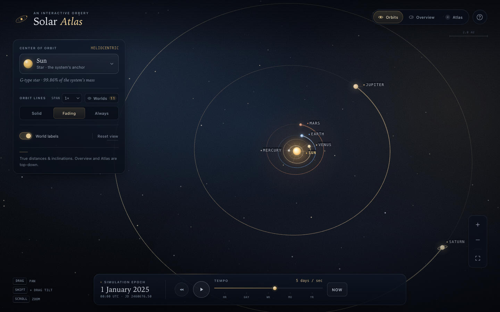
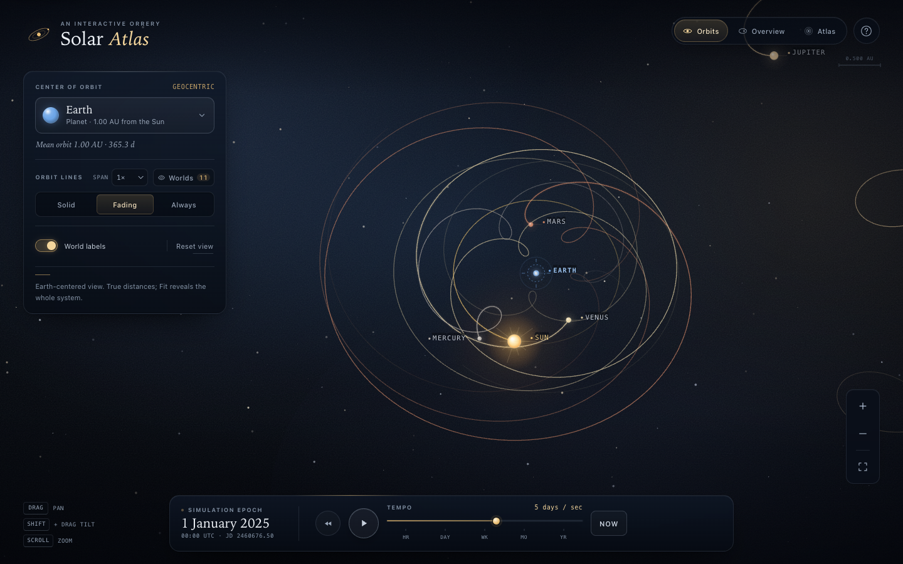
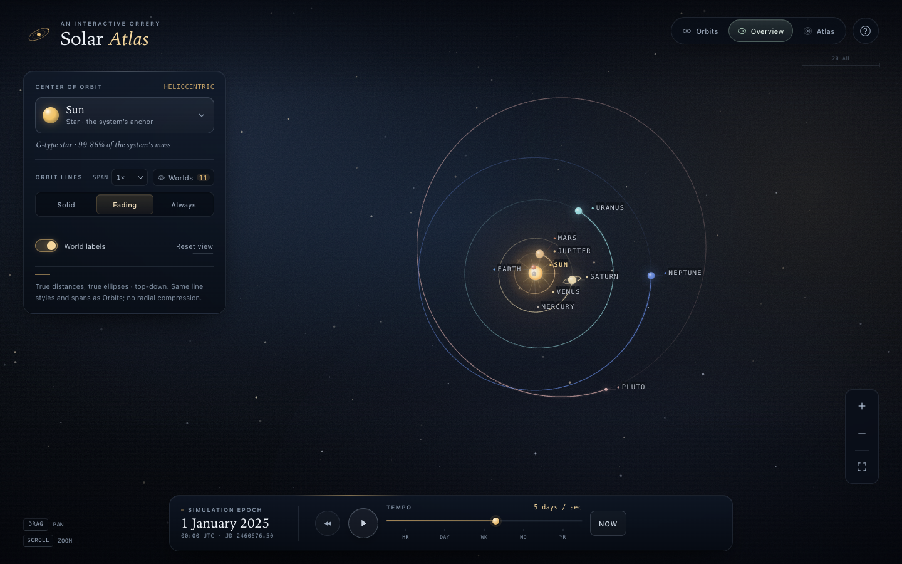
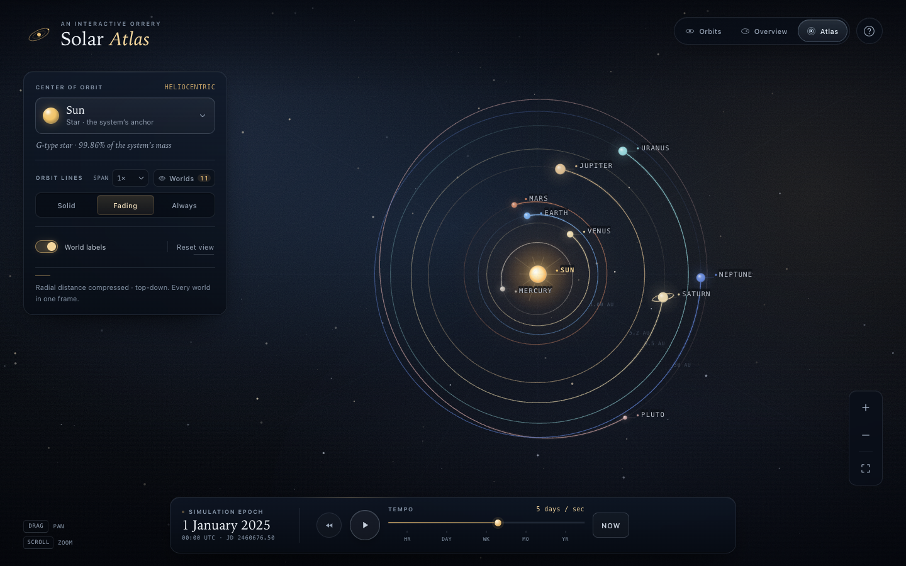
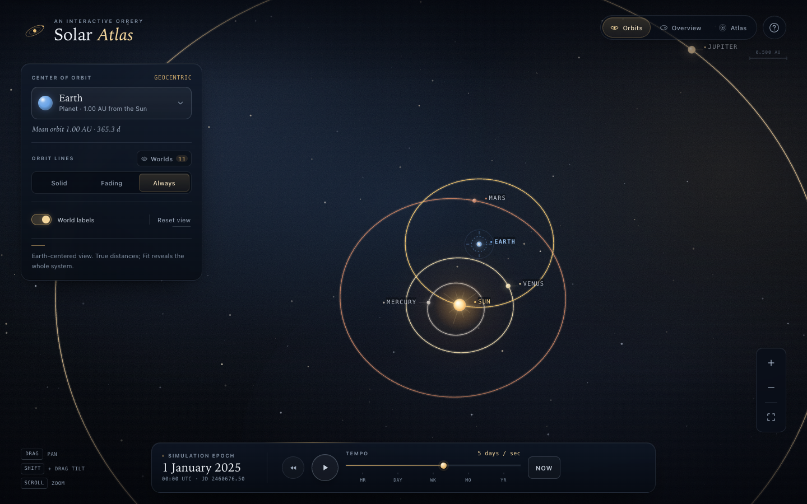
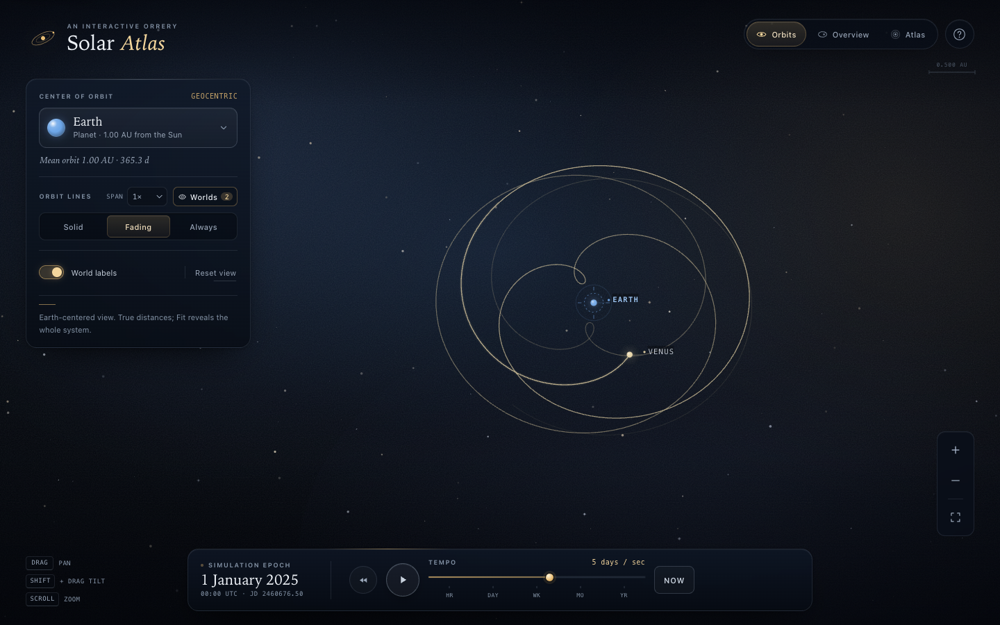
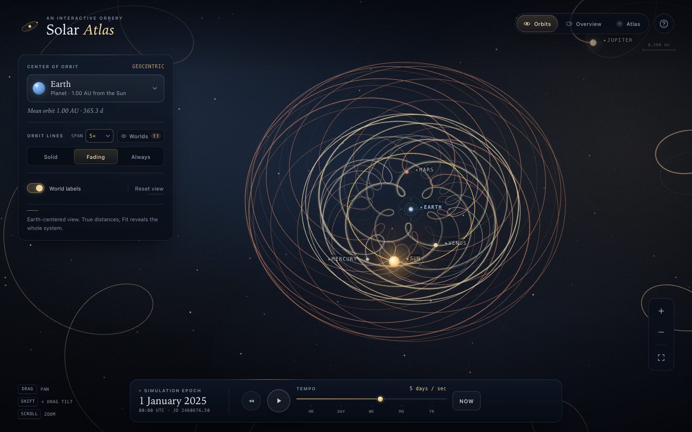
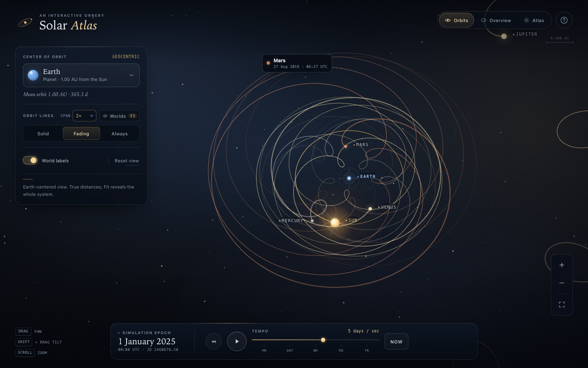
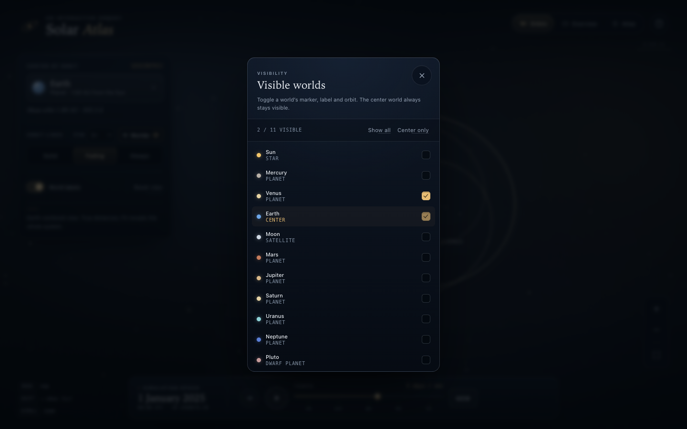

# Solar Atlas

**A real-time, true-orbit atlas of the Solar System — centered on any world.**

Open the orrery and watch the planets move along their real Keplerian paths. Change the center
of the view to the Sun, Earth, Jupiter, the Moon, or any other body, and every orbit is
recomputed around that new anchor. Switch between glowing comet trails, clean solid lines, and complete, full-brightness orbits, stretch the trail history from half to fifty times its default span,
scrub the tempo from hours to years per second, and switch between a top-down, true-scale Overview view — with the same line styles as
Orbits — and an Atlas that compresses distance so all eleven worlds fit in one composed view.

**Live site:** [seekahead.eu/solar](https://seekahead.eu/solar/) · [GitHub Pages mirror](https://david-batranu.github.io/solar-atlas/)

Built with vanilla JavaScript and Canvas 2D. No frameworks, no runtime dependencies, no
external fonts or images. Every world can be shown or hidden independently, including its label and orbit.

## Preview


*True-scale heliocentric view with fading orbital trails.*


*The same moment centered on Earth: the apparent solar path and the inner worlds' geocentric rosettes.*


*Overview view: top-down at true scale with no radial compression. This preview uses Fading at 5× span; Solid and Always work here exactly as they do in Orbits.*


*Atlas view: all eleven worlds in one top-down, radially compressed map.*


*Always style: each world’s complete orbit is drawn as a closed, full-brightness loop around its parent, translated into the selected center’s frame. Here Earth is the center; no segment fades.*


*An Earth-centered view reduced to just Earth and Venus. The Worlds control hides each world’s marker, label and orbit; the center world stays visible.*


*Five times the default history in an Earth-centered Fading view. The Span selector stretches the trail window, and Fading leaves a faint guide over the whole span so older positions remain visible.*


*Hovering any orbit line reveals the exact UTC date and time at that position, even on faded history.*


*The Worlds checklist. Show all, clear to the center, then tick the worlds you want to inspect.*


## Run it

```bash
# development site (ES modules need a local server)
node scripts/serve.mjs
# open http://127.0.0.1:4173
```

Or build a single self-contained file and double-click it:

```bash
node scripts/build-single-file.mjs
# dist/solar-atlas.html — works from file:// with no server
```

Node 18+ is recommended. There is no install step.

## What you can do

| Gesture / control | Action |
| --- | --- |
| **Center picker** in the left panel | Re-anchor the whole map on the Sun, a planet, Pluto, or the Moon. |
| **Click a world or its label** | Centre the map on that world. |
| **Hover an orbit point** | See the body and the UTC date/time it occupied that point. |
| **Orbit lines: Solid / Fading / Always** | Continuous hairlines, luminous comet-tail trails, or complete closed orbits at full brightness with no fading. Always shows each world’s full orbit around its parent, translated into the current center’s frame. Available in Orbits, Overview and Atlas. |
| **Visible worlds** | Open **Worlds** beside Orbit lines to show or hide any world’s marker, label and orbit. Use **Center only** to clear the field, then tick the worlds you want. The center world is always visible. |
| **Span** beside Orbit lines | Stretch or shorten the Solid/Fading history from 0.5× to 50× its default window. Longer spans keep older positions available; Fading adds a faint guide across the whole window so its oldest end does not disappear. |
| **Orbits / Overview / Atlas** | Tilted true-scale view; top-down true-scale view with no radial compression; or the top-down radially compressed whole-system map. Overview uses the same line style and Span controls as Orbits. |
| **Drag** | Pan the map. |
| **Shift + drag** | Tilt and rotate the orbit view (locked in Overview and Atlas). |
| **Scroll / pinch** | Zoom toward the pointer or pinch center. |
| **Play / reverse**, tempo slider, HR–YR presets | Control simulated time from 30 minutes to one year per real second, forwards or backwards. |
| **Now** | Return to the present moment. |
| **Fit view** | Frame every orbit in the current center and mode. |
| **World labels** | Toggle the canvas labels. |
| **Reset view** | Heliocentric, true distances, fading orbits, all worlds visible, default framing. |

Keyboard: `Space` play/pause · `F` fit · `A` toggle Atlas · `O` toggle Overview · `V` visible worlds · `R` reset · `1`–`5` hour/day/week/month/year per second · `+`/`-` zoom · arrows pan · `Shift`+arrows tilt · `?` or `H` help · `Esc` close.

The URL records `center`, `mode`, `trail`, `span`, `labels`, and hidden worlds (`hide=mercury,jupiter`), so any view can be shared. `mode=overview` selects the top-down true-scale view; the earlier `mode=elliptic` links still map to it. Add `date=2025-01-01T00:00:00Z` or `paused=1` for a fixed scene.

## Orbit model

- **Planets and Pluto** use the JPL Solar System Dynamics *Approximate Positions of the
  Planets* Keplerian elements and rates, valid 1800–2050. Outside that era the broader
  3000 BC–3000 AD fit is used, with the extra periodic terms for Jupiter through Neptune;
  the time-bar marks this as an *extended solution*. Positions are geometric, J2000
  ecliptic, in AU; no light-time, aberration, or nutation is applied.
- **The Moon** is computed with a truncated Meeus *Astronomical Algorithms* chapter 47
  lunar theory (60 longitude/distance terms plus latitude terms and additive perturbations),
  then precessed to J2000. Earth itself is the Earth–Moon barycenter, matching the JPL
  planetary fit; the lunar offset is added on top.
- **Every orbit line is computed, not hand-drawn.** In heliocentric view the sampled curves
  are the real eccentric, inclined ellipses. In a planet-centric view, positions are differenced
  against the moving center at the same instant, so the trails are the true geocentric /
  areocentric / etc. rosettes and retrograde loops over several synodic periods.
- **Long history stays curved.** The Span selector scales the ephemeris sampling with the requested history, and trace paths are drawn with a smooth Catmull–Rom interpolation through the samples. This keeps extended 5×–50× geocentric rosettes from turning into visible polygons; *Always* ignores Span and renders complete parent orbits.
- **Overview mode** is top-down at true scale, with no radial compression, and keeps the same Solid/Fading/Always and Span behavior as Orbits. Use *Always* for the complete Keplerian ellipses; in heliocentric view the Sun sits at one focus, and in a planet-centered view the same parent ellipses are translated into that center’s frame. Fit shows the whole true-scale system, but the outer planets are necessarily small.
- **Atlas mode** is the one deliberate distortion: only the radius is compressed
  (`r' = ln(1 + r / 0.18)`), preserving every angle and orbital shape. A logarithmic scale
  brings Mercury and Neptune into the same frame.
- **Sizes are schematic.** Planet distances and inclination are true in *Orbits* and *Overview* modes; marker
  radii are exaggerated so worlds remain visible. Atlas adds a further 20% to markers.
- **Accuracy.** Against JPL Horizons state vectors at 2025-01-01, the ephemeris implements
  positions within roughly `5e-6` AU (Mercury) to `1.4e-2` AU (Saturn); the lunar position
  agrees within a few kilometres. See `tests/ephemeris.test.mjs` and the fixtures in
  `test/fixtures/`.
- Pluto's orbit is a best-fit approximation; treat it as illustrative rather than precision
  astrometry. The app is an exploratory orrery, not a navigation or observation tool.

## Project layout

```
index.html                  development entry point
src/css/styles.css          observatory visual system; responsive, reduced-motion aware
src/js/data.js              body metadata, colors, periods, physical facts
src/js/ephemeris.js         Keplerian planet model + Meeus lunar theory
src/js/orbits.js            center-relative traces, synodic windows, Atlas compression
src/js/camera.js            orthographic 3D camera, zoom-to-cursor, symmetric fitting
src/js/renderer.js          Canvas rendering: stars, trails, worlds, labels, HUD
src/js/ui.js                DOM controller, center picker, transport, modal
src/js/main.js              application state, time engine, interactions, RAF loop
scripts/serve.mjs           zero-dependency local static server
scripts/build-single-file.mjs   dependency-free mini-bundler for dist/solar-atlas.html
tests/                      46 science, geometry, and camera tests
test/fixtures/              JPL Horizons reference vectors
CONTRACT.md                 internal engineering contract and module interfaces
```

## Tests

```bash
npm test
```

Covers Kepler solving across eccentricities, J2000/Unix conversions, heliocentric positions
against JPL Horizons, lunar distance and position, trace window rules and transform invariants,
Atlas compression, camera projection, zoom anchoring, symmetric fitting, and interpolation.

## Accessibility & performance

- Full keyboard support, visible focus rings, ARIA labels on all controls, a live region for
  state changes, a focus-trapped help dialog, reduced-motion support, and a skip link.
- Canvas text is drawn with a dark keyline for contrast; labels use collision-aware placement.
- Simulation runs at ~60 fps on a 2020-era laptop at the default history span, with 10 orbit
  traces, fading gradients, labels, and the star field; trace geometry is throttled and bridged
  to the live planet position between rebuilds. Long-history modes scale their sampling with
  the selected Span.
- Mobile keeps the center picker and orbit-style controls above the stage; the secondary labels
  and reset row is intentionally omitted there to give the map room, while desktop/tablet float
  the full instrument panel.

## Credits

Planetary elements: NASA/JPL-Caltech Solar System Dynamics, *Approximate Positions of the
Planets* (Standish & Williams). Lunar theory: Jean Meeus, *Astronomical Algorithms*, ch. 47.
Physical data: NASA/JPL planetary and satellite fact sheets. Reference state vectors:
JPL Horizons. Everything is rendered locally.
